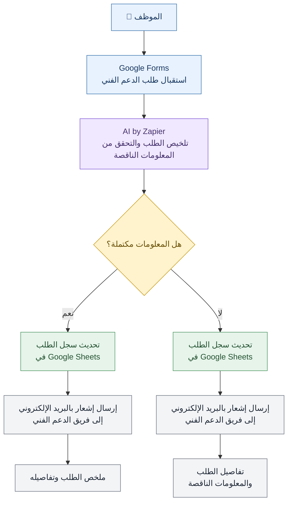

# نظام أتمتة طلبات الدعم الفني | IT Support Request Automation System

[English](README.md) | [العربية](README.ar.md)

أتمتة معالجة طلبات الدعم الفني باستخدام Zapier والذكاء الاصطناعي لتلخيص الطلبات، والتحقق من المعلومات الناقصة، وتوجيهها إلى المسار المناسب مع تسجيلها وإحالتها إلى الجهات المختصة.

---

## 🎯 Problem | المشكلة

### The Context | السياق

يستقبل فريق الدعم الفني طلبات الموظفين المتعلقة بالمشكلات التقنية، ويقوم بمراجعتها ومتابعة تفاصيلها لتحديد طبيعة المشكلة والجهة المسؤولة عن معالجتها.

### The Problem | المشكلة

يقوم الموظفون بإرسال طلبات الدعم الفني عبر النموذج، مما يجعل تنظيم المشاكل وتصنيفها وتحديد أهميتها يدويًا أمرًا صعبًا.

### Why It Matters | أهمية المشكلة

- تقليل المهام اليدوية المتكررة.
- تحسين وضوح طلبات الدعم الفني وتنظيمها.
- اكتشاف المعلومات الناقصة قبل متابعة معالجة الطلب.
- توجيه الطلبات إلى المسار المناسب وفقًا لشروط محددة.
- تسهيل تسجيل الطلبات ومتابعتها من قبل فريق الدعم الفني.

---

## 💡 Solution | الحل

أتمتة تعتمد على الذكاء الاصطناعي لتلخيص مشاكل الموظفين، وتصنيف أنواعها، وتحديد أهميتها، وتوجيه الطلبات إلى الدعم الفني أو المراجعة البشرية.

### ماذا يفعل النظام؟

1. يستقبل طلبات الدعم الفني من خلال Google Forms.
2. يستخدم AI by Zapier لتلخيص الطلب ومراجعة المعلومات الناقصة.
3. يوجّه الطلب وفقًا لحالته وشروط سير العمل.
4. يسجّل الطلبات التي تتبع المسار الاعتيادي في Google Sheets ويرسلها إلى فريق الدعم الفني.
5. يوجّه الطلبات التي تحتاج إلى مراجعة إضافية إلى مسار المراجعة البشرية.

---

## 👤 Users | المستخدمون

**المستخدمون الأساسيون:**

- الموظفون الذين يواجهون مشكلات تقنية.
- فريق الدعم الفني المسؤول عن متابعة الطلبات ومعالجة المشكلات.

**احتياجات المستخدمين:**

- **الموظفون:** وسيلة بسيطة لتقديم طلبات الدعم الفني.
- **فريق الدعم الفني:** طلبات واضحة ومنظمة تحتوي على المعلومات اللازمة لفهم المشكلة.

---

## 🧠 How I Designed the Solution | كيف صممت الحل؟

اعتمد تصميم سير العمل على ثلاثة اعتبارات أساسية:

### 1. جودة المعلومات

استخدام الذكاء الاصطناعي لتلخيص الطلبات والتحقق من اكتمال المعلومات قبل متابعة معالجتها.

### 2. التوجيه الشرطي

تقسيم سير العمل إلى مسارات مختلفة بدلًا من التعامل مع جميع الطلبات بالطريقة نفسها.

### 3. المراجعة البشرية

تخصيص مسار للطلبات التي تحتاج إلى مراجعة إضافية، بدلًا من الاعتماد على المعالجة الآلية في جميع الحالات.

---

## ⚙️ How It Works | آلية عمل النظام

---

## 🤖 Role of AI | دور الذكاء الاصطناعي

### ماذا يفعل الذكاء الاصطناعي في هذا الحل؟

- **تلخيص الطلبات:** تلخيص طلبات الدعم الفني.
- **اكتشاف المعلومات الناقصة:** تحديد المعلومات التي تبدو ناقصة أو غير كافية لفهم المشكلة.
- **دعم معالجة الطلبات:** تقديم مخرجات تساعد في معالجة الطلب وتوجيهه وفقًا لمنطق سير العمل.

### ما الذي يجب ألا يفعله الذكاء الاصطناعي؟

- **اختلاق المعلومات:** عدم إنشاء معلومات لم يقدّمها الموظف.
- **افتراض المعلومات الناقصة:** عدم اعتبار المعلومات الناقصة معلومات مؤكدة.
- **اتخاذ قرارات تتطلب حكمًا بشريًا دون مراجعة:** ضمان وجود مسار للمراجعة البشرية عند الحاجة.
- **استبدال فريق الدعم الفني:** عدم استبدال دور فريق الدعم الفني في تشخيص المشكلات التقنية وحلها.

---

## 🔄 Automation | الأتمتة

تشمل المهام المؤتمتة في المشروع:

- استقبال طلبات الموظفين من النموذج.
- تلخيص الطلبات باستخدام الذكاء الاصطناعي.
- مراجعة المعلومات المقدمة وتحديد النواقص المحتملة.
- توجيه الطلبات وفقًا للشروط المحددة في سير العمل.
- تسجيل الطلبات في Google Sheets للمسار المخصص لذلك.
- إرسال الطلبات إلى فريق الدعم الفني أو توجيهها إلى مسار المراجعة البشرية.

---

## 🗂️ Data | البيانات

### Input | المدخلات

البيانات التي يقدّمها الموظف من خلال Google Forms، مثل:

- اسم الموظف.
- البريد الإلكتروني للموظف.
- وصف المشكلة التقنية.

### Output | المخرجات

- **ملخص الطلب:** ملخص يتم إنشاؤه بواسطة الذكاء الاصطناعي.
- **المعلومات الناقصة:** تحديد المعلومات التي قد تكون غير متوفرة.
- **قرار التوجيه:** توجيه الطلب إلى المسار المناسب.
- **سجل الطلب:** تسجيل الطلب في Google Sheets عند اتباع المسار الاعتيادي.
- **الإشعارات:** إرسال الطلب إلى فريق الدعم الفني أو إحالته إلى المراجعة البشرية، وفقًا لمسار المعالجة.

---

## 🛠️ Tools & Technologies | الأدوات والتقنيات

| الأداة | الاستخدام |
|---|---|
| Zapier | إنشاء سير العمل وربط خطوات الأتمتة |
| Google Forms | استقبال طلبات الدعم الفني |
| AI by Zapier | تلخيص الطلبات ومراجعة المعلومات |
| Google Sheets | تسجيل الطلبات وتنظيم بياناتها |
| Gmail | إرسال الطلبات إلى الجهة المعنية |

---

## 🔑 Key Design Decisions | القرارات التصميمية

### القرار الأول: التحقق من اكتمال معلومات الطلب

**القرار:**

تقسيم الطلبات إلى مسارين بناءً على اكتمال المعلومات المقدمة من الموظف.

**السبب:**

لضمان التمييز بين الطلبات التي تحتوي على معلومات كافية للمتابعة والطلبات التي تحتاج إلى استكمال معلوماتها.

### القرار الثاني: تخصيص الإشعارات حسب حالة الطلب

**القرار:**

إرسال إشعار بالبريد الإلكتروني لفريق الدعم الفني بمحتوى مختلف حسب نتيجة التحقق.

عند اكتمال المعلومات، يتضمن الإشعار تفاصيل الطلب وملخصه، وعند عدم اكتمالها، يوضح المعلومات الناقصة.

**السبب:**

مساعدة فريق الدعم الفني على فهم حالة كل طلب وتحديد الإجراء المناسب دون الحاجة إلى مراجعة جميع التفاصيل يدويًا في كل مرة.

---

## 🧪 Testing | الاختبار

### الاختبار الأول: طلب دعم فني مكتمل المعلومات

**المدخلات:**

طلب دعم فني يحتوي على معلومات كافية لفهم المشكلة.

**النتيجة المتوقعة:**

- إنشاء ملخص للطلب.
- اتباع مسار المعالجة الاعتيادية وفقًا للشروط المحددة.
- تسجيل الطلب في Google Sheets.
- إرسال الطلب إلى فريق الدعم الفني.

**النتيجة الفعلية:**

تم توجيه الطلب إلى مسار المعالجة الصحيح، وتحديث سجل الطلب، وإرسال إشعار لفريق الدعم الفني يتضمن تفاصيل الطلب.

**الحالة:** ✅ Pass

---

### الاختبار الثاني: طلب دعم فني يحتوي على معلومات ناقصة

**المدخلات:**

طلب دعم فني يفتقر إلى بعض التفاصيل المهمة لفهم المشكلة.

**النتيجة المتوقعة:**

- تحديد المعلومات الناقصة المحتملة.
- توجيه الطلب وفقًا لشروط سير العمل.
- إحالته إلى المسار المناسب بحسب نتيجة المراجعة.

**النتيجة الفعلية:**

تم توجيه الطلب إلى مسار المراجعة البشرية، وتحديث سجل الطلب، وإرسال إشعار لفريق الدعم الفني يتضمن حالة الطلب وتفاصيله.

**الحالة:** ✅ Pass

---

## 📸 Evidence | الأدلة

### Final Result | النتائج النهائية

[Test1](./Screenshots/Test1.png)

[Test2](./Screenshots/Test2.png)

### Workflow | سير العمل

[Workflow](./Screenshots/workflow.png)

---

## ⚠️ Challenges & Failures | التحديات والإخفاقات

### ما أبرز التحديات؟

- **التعامل مع الطلبات غير المكتملة:** ضمان اكتشاف الطلبات التي تحتوي على معلومات غير كافية بدلًا من التعامل معها على أنها مكتملة.
- **موثوقية مخرجات الذكاء الاصطناعي:** ضمان أن تعكس الملخصات الناتجة عن الذكاء الاصطناعي محتوى طلب الموظف الأصلي بدقة دون اختلاق معلومات ناقصة.
- **التوجيه الشرطي لسير العمل:** تصميم مسارات معالجة منفصلة للتعامل بشكل صحيح مع الطلبات المكتملة وغير المكتملة.
- **اتساق البيانات:** ضمان تحديث سجلات الطلبات وإرسال الإشعارات المناسبة وفقًا لكل مسار من مسارات المعالجة.

### كيف تعاملت مع هذه التحديات؟

- استخدام الذكاء الاصطناعي لتلخيص الطلبات وتحديد المعلومات التي قد تكون ناقصة.
- تحديد شروط واضحة في سير العمل للتمييز بين الطلبات المكتملة وغير المكتملة.
- فصل مسارات المعالجة لضمان التعامل مع كل طلب بالطريقة المناسبة.
- ربط Google Sheets وGmail لتسجيل معلومات الطلبات وإشعار الفريق المعني.

---

## 📚 What I Learned | ما تعلمته

### الدرس التقني

تعلمت كيفية ربط Google Forms وAI by Zapier وGoogle Sheets وGmail لبناء سير عمل مؤتمت يعالج الطلبات الواردة ويتعامل مع النتائج المختلفة باستخدام التوجيه الشرطي.

### درس حل المشكلات

تعلمت أهمية تصميم سير العمل بناءً على سيناريوهات مختلفة بدلًا من افتراض أن جميع الطلبات الواردة ستحتوي على معلومات مكتملة. وجود مسارات منفصلة يجعل العملية أكثر تنظيمًا وأسهل في الإدارة.

### درس الذكاء الاصطناعي

تعلمت أن الذكاء الاصطناعي يجب أن يدعم معالجة المعلومات بدلًا من افتراضها. من المهم التمييز بين المعلومات المقدمة والتفاصيل الناقصة، مع الحفاظ على دور الإنسان في الحالات التي تتطلب مراجعة إضافية.

---

## 🔮 Future Improvements | التحسينات المستقبلية

في حال مواصلة تطوير هذا المشروع، سأعمل على:

- إضافة إشعارات متابعة تلقائية للطلبات التي لم يتم حلها بعد.
- تطوير آلية لتتبع حالة كل طلب منذ تقديمه وحتى الانتهاء من معالجته.

---
