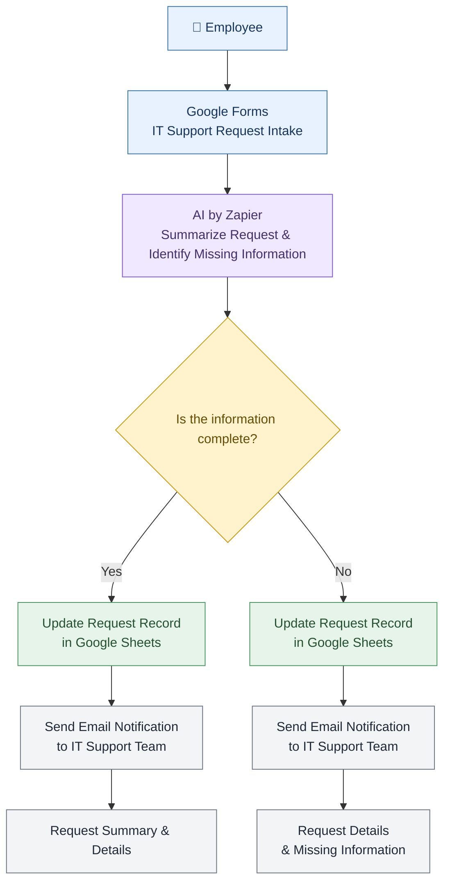

# IT Support Request Automation System

Automating IT support request processing using Zapier and AI to summarize requests, identify missing information, and route them to the appropriate path while recording and forwarding them to the relevant teams.

---

## 🎯 Problem

### The Context

The IT support team receives employee requests related to technical issues and reviews and follows up on their details to identify the nature of each problem and the team responsible for resolving it.

### The Problem

Employees submit IT support requests through a form, making it difficult to manually organize, categorize, and determine the priority of reported issues.

### Why It Matters

- Reduce repetitive manual tasks.
- Improve the clarity and organization of IT support requests.
- Identify missing information before proceeding with request processing.
- Route requests to the appropriate path based on predefined conditions.
- Make it easier for the IT support team to record and track requests.

---

## 💡 Solution

An AI-powered automation workflow designed to summarize employee issues, identify missing information, and route requests to either the IT support team or human review.

### What does the system do?

1. Receives IT support requests through Google Forms.
2. Uses AI by Zapier to summarize each request and identify missing information.
3. Routes requests according to their status and predefined workflow conditions.
4. Records requests following the regular processing path in Google Sheets and sends them to the IT support team.
5. Routes requests requiring additional review to the human review path.

---

## 👤 Users

**Primary Users:**

- Employees experiencing technical issues.
- The IT support team responsible for following up on requests and resolving technical problems.

**User Need:**

- **Employees:** A simple way to submit IT support requests.
- **IT Support Team:** Clear and organized requests containing the information needed to understand each issue.

---

## 🧠 How I Designed the Solution

The workflow was designed around three main considerations:

### 1. Information Quality

Using AI to summarize requests and verify information completeness before proceeding with processing.

### 2. Conditional Routing

Dividing the workflow into different paths instead of handling all requests in the same way.

### 3. Human Review

Providing a dedicated path for requests that require additional review instead of relying entirely on automated processing in every case.

---

## ⚙️ How It Works

---

## 🤖 Role of AI

### What does AI do in this solution?

- **Request Summarization:** Summarize IT support requests.
- **Missing Information Detection:** Identify information that appears to be missing or insufficient to understand the reported issue.
- **Processing Support:** Provide outputs that help process and route requests according to the workflow logic.

### What AI Should NOT Do

- **Invent Information:** Never generate information that the employee has not provided.
- **Assume Missing Information Is Confirmed:** Never treat missing information as verified information.
- **Make Decisions Requiring Human Judgment Without Review:** Ensure that requests can be sent for human review when necessary.
- **Replace the IT Support Team:** AI should not replace the IT support team's role in diagnosing and resolving technical issues.

---

## 🔄 Automation

The automated tasks in this project include:

- Receiving employee requests through the form.
- Summarizing requests using AI.
- Reviewing submitted information and identifying potential missing details.
- Routing requests according to predefined workflow conditions.
- Recording requests in Google Sheets for the designated processing path.
- Sending requests to the IT support team or routing them to the human review path.

---

## 🗂️ Data

### Input

Information submitted by employees through Google Forms, such as:

- Employee name.
- Employee email address.
- Description of the technical issue.

### Output

- **AI-Generated Summary:** A summary of the submitted request.
- **Missing Information:** Identification of information that may be missing.
- **Routing Decision:** Directing the request to the appropriate path.
- **Request Record:** Recording the request in Google Sheets when it follows the regular processing path.
- **Notification:** Sending the request to the IT support team or forwarding it for human review, depending on the processing path.

---

## 🛠️ Tools & Technologies

| Tool | Purpose |
|---|---|
| Zapier | Building the workflow and connecting automation steps |
| Google Forms | Collecting IT support requests |
| AI by Zapier | Summarizing requests and reviewing information |
| Google Sheets | Recording requests and organizing their data |
| Gmail | Sending requests to the relevant team |

---

## 🔑 Key Design Decisions

### Decision 1: Validating Request Information Completeness

**Decision:**

Divide requests into two paths based on the completeness of the information provided by the employee.

**Why:**

To distinguish between requests containing sufficient information for follow-up and requests that need additional information.

### Decision 2: Customizing Notifications Based on Request Status

**Decision:**

Send email notifications to the IT support team with different content depending on the validation result.

When information is complete, the notification includes the request details and summary. When information is incomplete, it highlights the missing information.

**Why:**

To help the IT support team understand the status of each request and determine the appropriate action without manually reviewing all details every time.

---

## 🧪 Testing

### Test 1: Complete IT Support Request

**Input:**

An IT support request containing sufficient information to understand the reported issue.

**Expected Result:**

- Generate a summary of the request.
- Follow the regular processing path according to the predefined conditions.
- Record the request in Google Sheets.
- Send the request to the IT support team.

**Actual Result:**

The request was routed through the correct processing path, the request record was updated, and a notification containing the request details was sent to the support team.

**Status:** ✅ Pass

---

### Test 2: IT Support Request with Missing Information

**Input:**

An IT support request missing some important details needed to understand the issue.

**Expected Result:**

- Identify potentially missing information.
- Route the request according to the workflow conditions.
- Forward it to the appropriate path based on the review result.

**Actual Result:**

The request was routed to the human review path, the request record was updated, and a notification containing the request status and details was sent to the support team.

**Status:** ✅ Pass

---

## 📸 Evidence

### Final Result

[Test1](./Screenshots/Test1.png)

[Test2](./Screenshots/Test2.png)

### Workflow

[Workflow](./Screenshots/workflow.png)

---

## ⚠️ Challenges & Failures

### What were the main challenges?

- **Handling Incomplete Requests:** Ensuring that requests with insufficient information are identified instead of being treated as complete.
- **AI Output Reliability:** Ensuring that AI-generated summaries accurately reflect the employee's original request without inventing missing details.
- **Conditional Workflow Routing:** Designing separate processing paths to handle complete and incomplete requests correctly.
- **Data Consistency:** Ensuring that request records are updated and the appropriate notification is sent according to each processing path.

### How did I address these challenges?

- Used AI to summarize requests and identify potentially missing information.
- Defined clear workflow conditions to distinguish between complete and incomplete requests.
- Separated the processing paths to ensure that each request receives the appropriate handling.
- Connected Google Sheets and Gmail to record request information and notify the relevant team.

---

## 📚 What I Learned

### Technical Lesson

I learned how to connect Google Forms, AI by Zapier, Google Sheets, and Gmail to build an automated workflow that processes incoming requests and handles different outcomes using conditional routing.

### Problem-Solving Lesson

I learned the importance of designing workflows around different scenarios rather than assuming that all incoming requests will contain complete information. Providing separate paths makes the process more organized and easier to manage.

### AI Lesson

I learned that AI should support information processing rather than make assumptions. It is important to distinguish between provided information and missing details, and to maintain human involvement when additional review is required.

---

## 🔮 Future Improvements

If I continued developing this project, I would:

- Introduce request status tracking to monitor progress from submission to resolution.
- Add automated follow-up notifications for requests that remain unresolved.

## 🔗 Project Links

**Workflow:** [https://zapier.com/editor/00000000-0000-c000-8000-000383165820/published]

**Repository:** [https://github.com/mahaalzenati/Final/tree/main]

---

## 👩‍💻 Author

**[Maha Alzenati]**

[LinkedIn](https://www.linkedin.com/in/maha-alzenati-gamedev/) · [GitHub](https://github.com/mahaalzenati)
