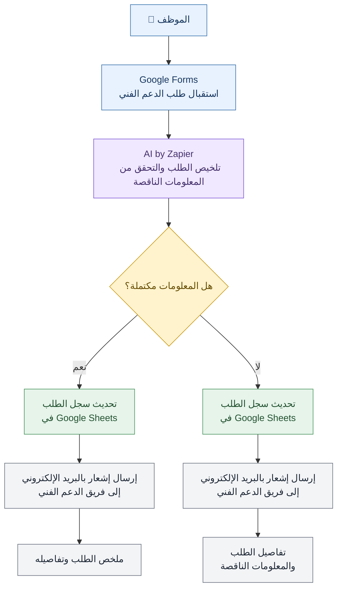

# [IT support]

> أتمتة معالجة طلبات الدعم الفني باستخدام Zapier والذكاء الاصطناعي لتلخيص الطلبات، والتحقق من المعلومات الناقصة، وتوجيهها إلى المسار المناسب مع تسجيلها وإحالتها للجهات المختصة.

---

## 🎯 Problem

### The Context

يستقبل فريق الدعم الفني طلبات الموظفين المتعلقة بالمشكلات التقنية، ويقوم بمراجعتها ومتابعة تفاصيلها لتحديد طبيعة المشكلة والجهة المسؤولة عن معالجتها.
### The Problem

يقوم الموظفون بإرسال طلبات الدعم الفني عبر الفورم، مما يجعل تنظيم المشاكل وتصنيفها وتحديد أهميتها يدويًا أمرًا صعبًا.

### Why It Matters

- تقليل المهام اليدوية المتكررة.
- تحسين وضوح طلبات الدعم الفني وتنظيمها.
- اكتشاف المعلومات الناقصة قبل متابعة معالجة الطلب.
- توجيه الطلبات إلى المسار المناسب وفقًا لشروط محددة.
- تسهيل تسجيل الطلبات ومتابعتها من قبل فريق الدعم الفني.
---

## 💡 Solution

أتمتة تعتمد على الذكاء الاصطناعي لتلخيص مشاكل الموظفين، وتصنيف أنواعها، وتحديد أهميتها، وتوجيه الطلبات إلى الدعم الفني أو المراجعة البشرية.
What does the system do?

1. يستقبل طلبات الدعم الفني من خلال Google Forms.
2. يستخدم AI by Zapier لتلخيص الطلب ومراجعة المعلومات الناقصة.
3. يوجّه الطلب وفقًا لحالته وشروط سير العمل.
4. يسجّل الطلبات التي تتبع المسار الاعتيادي في Google Sheets ويرسلها إلى فريق الدعم الفني.
5. يوجّه الطلبات التي تحتاج إلى مراجعة إضافية إلى مسار المراجعة البشرية.
---

## 👤 Users

**Primary Users:**  

- الموظفون الذين يواجهون مشكلات تقنية.
- فريق الدعم الفني المسؤول عن متابعة الطلبات ومعالجة المشكلات.
**User Need:**  
- **الموظفون:** وسيلة بسيطة لتقديم طلبات الدعم الفني.
- **فريق الدعم الفني:** طلبات واضحة ومنظمة تحتوي على المعلومات اللازمة لفهم المشكلة.

---

## 🧠 How I Designed the Solution

اعتمد تصميم سير العمل على ثلاثة اعتبارات أساسية:

### 1. جودة المعلومات
استخدام الذكاء الاصطناعي لتلخيص الطلبات والتحقق من اكتمال المعلومات قبل متابعة معالجتها.

### 2. التوجيه الشرطي
تقسيم سير العمل إلى مسارات مختلفة بدلًا من التعامل مع جميع الطلبات بالطريقة نفسها.

### 3. المراجعة البشرية
تخصيص مسار للطلبات التي تحتاج إلى مراجعة إضافية، بدلًا من الاعتماد على المعالجة الآلية في جميع الحالات.

## ⚙️ How It Works

## ⚙️ آلية عمل النظام (How It Works)

---

## 🤖 Role of AI

What does AI do in this solution?

- تلخيص طلبات الدعم الفني.
- تحديد المعلومات التي تبدو ناقصة أو غير كافية لفهم المشكلة.
- تقديم مخرجات تساعد في معالجة الطلب وتوجيهه وفقًا لمنطق سير العمل.

### What AI Should NOT Do

- اختلاق معلومات لم يقدّمها الموظف.
- اعتبار المعلومات الناقصة معلومات مؤكدة.
- اتخاذ قرارات تتطلب حكمًا بشريًا دون إتاحة مسار للمراجعة عند الحاجة.
- استبدال دور فريق الدعم الفني في تشخيص المشكلات وحلها.
---

## 🔄 Automation

تشمل المهام المؤتمتة في المشروع:

- استقبال طلبات الموظفين من النموذج.
- تلخيص الطلبات باستخدام الذكاء الاصطناعي.
- مراجعة المعلومات المقدمة وتحديد النواقص المحتملة.
- توجيه الطلبات وفقًا للشروط المحددة في سير العمل.
- تسجيل الطلبات في Google Sheets للمسار المخصص لذلك.
- إرسال الطلبات إلى فريق الدعم الفني أو توجيهها إلى مسار المراجعة البشرية.

---

## 🗂️ Data

### Input

البيانات التي يقدّمها الموظف من خلال Google Forms، مثل:
-اسم الموظف.
-ايميل الموظف.
-وصف المشكلة التقنية.
### Output

- ملخص للطلب تم إنشاؤه بواسطة الذكاء الاصطناعي.
- تحديد المعلومات التي قد تكون ناقصة.
- توجيه الطلب إلى المسار المناسب.
- تسجيل الطلب في Google Sheets عند اتباع المسار الاعتيادي.
- إرسال الطلب إلى فريق الدعم الفني أو إحالته إلى المراجعة البشرية، وفقًا لمسار المعالجة.

---

## 🛠️ Tools & Technologies

| الأداة | الاستخدام |
|---|---|
| Zapier | إنشاء سير العمل وربط خطوات الأتمتة |
| Google Forms | استقبال طلبات الدعم الفني |
| AI by Zapier | تلخيص الطلبات ومراجعة المعلومات |
| Google Sheets | تسجيل الطلبات وتنظيم بياناتها |
| Gmail| إرسال الطلبات إلى الجهة المعنية |

---

## 🔑 Key Design Decisions
**القرار 1: التحقق من اكتمال معلومات الطلب**

**القرار**  
تقسيم الطلبات إلى مسارين بناءً على اكتمال المعلومات المقدمة من الموظف.

**السبب**
لضمان التمييز بين الطلبات التي تحتوي على معلومات كافية للمتابعة والطلبات التي تحتاج إلى استكمال معلوماتها.

**القرار 2: تخصيص الإشعارات حسب حالة الطلب**

**القرار**  
إرسال إشعار بالبريد الإلكتروني لفريق الدعم الفني بمحتوى مختلف حسب نتيجة التحقق؛ يتضمن تفاصيل الطلب وملخصه عند اكتمال المعلومات، أو يوضح المعلومات الناقصة عند عدم اكتمالها.

  **السبب**
  
مساعدة فريق الدعم الفني على فهم حالة كل طلب وتحديد الإجراء المناسب دون الحاجة إلى مراجعة جميع التفاصيل يدويًا في كل مرة.

---

## 🧪 Testing

### Test 1

**المدخلات:**

طلب دعم فني يحتوي على معلومات كافية لفهم المشكلة.

**النتيجة المتوقعة:**

- إنشاء ملخص للطلب.
- اتباع مسار المعالجة الاعتيادية وفقًا للشروط المحددة.
- تسجيل الطلب في Google Sheets.
- إرسال الطلب إلى فريق الدعم الفني.

**النتيجة الفعلية**  
تم توجيه الطلب لمسار المعالجة الصحيح وتحديث سجل الطلب وارسال اشعار لفريق الدعم بالتفاصيل.

**Status:** ✅

---

### Test 2

**المدخلات:**

طلب دعم فني يفتقر إلى بعض التفاصيل المهمة لفهم المشكلة.

**النتيجة المتوقعة:**

- تحديد المعلومات الناقصة المحتملة.
- توجيه الطلب وفقًا لشروط سير العمل.
- إحالته إلى المسار المناسب بحسب نتيجة المراجعة.

**النتيجة الفعلية**
تم توجيه الطلب لمسار المراجعة البشرية وتديث سجل الطلب وارسال اشعار لفريق الدعم بحالة الطلب وتفاصيله.
...

**Status:** ✅ 

---

## 📸 Evidence

### Final Result

[Test1](./Screenshots/Test1.png)

[Test2](./Screenshots/Test2.png)

### Workflow

---

## ⚠️ Challenges & Failures

What didn't work as expected?

- ...
- ...

How did I solve it?

- ...
- ...

---

## 📚 What I Learned

### Technical Lesson

...

### Problem-Solving Lesson

...

### AI Lesson

...

---

## 🔮 Future Improvements

If I continued developing this project, I would:

- ...
- ...
- ...

---

## 🔗 Project Links

**Live Demo:** [Link]

**Workflow:** [https://zapier.com/editor/00000000-0000-c000-8000-000383165820/published]

**Repository:** [Link]

---

## 👩‍💻 Author

**[Maha Alzenati]**

[LinkedIn](https://www.linkedin.com/in/maha-alzenati-gamedev/) · [GitHub](https://github.com/mahaalzenati)
