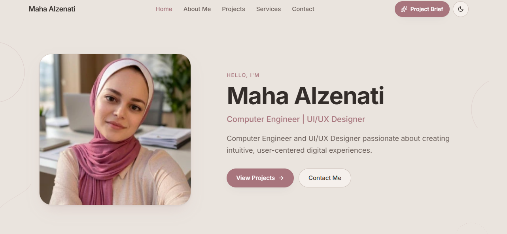

# Portfolio Website | Personal Portfolio

[English](README.md) | [العربية](README.ar.md)

> A personal portfolio website that allows recruiters and clients to explore qualifications, skills, projects, and services, while providing an AI-powered feature to organize project requirements into a clear summary.

---

## 🎯 Problem

### Context

Job seekers and freelancers use portfolio websites to showcase their skills, projects, and experience, while recruiters and clients rely on this information to evaluate whether the portfolio owner is a suitable candidate for a job opportunity or project.

### Problem

Visitors may find it difficult to access the information they need or understand the portfolio owner's qualifications, skills, and projects when the information is not well organized or is difficult to navigate.

Clients may also face difficulties explaining their project requirements and presenting them in an organized way that helps communicate their needs accurately.

### Why Does Solving This Problem Matter?

Organizing information, projects, and services helps visitors evaluate the portfolio owner more easily, improves the visitor experience, and facilitates communication and collaboration with potential clients.

---

## 💡 Solution

Creating an organized and responsive personal portfolio website that presents information, skills, projects, and services clearly, while allowing visitors to access contact channels easily.

The project also includes a proposed AI-powered feature that generates an organized summary of the project requirements entered by the client.

### What Does the System Provide?

1. Displays basic information, personal summary, skills, and qualifications.
2. Organizes projects and allows visitors to explore the details of each project.
3. Displays offered services and contact information.
4. Provides navigation between website sections with support for dark and light modes.
5. Provides a feature for generating a project requirements summary using AI, with the ability to download it as a PDF and send it via email, according to what has actually been implemented.

---

## 👤 Users

### Primary Users

- **Recruiters:** To review the portfolio owner's qualifications, skills, and projects and evaluate their suitability for job opportunities.
- **Potential Clients:** To explore services and projects and determine whether the portfolio owner is suitable for carrying out their projects.

### User Needs

- Quick access to information, skills, and qualifications.
- Easy exploration of projects and their details.
- Understanding the offered services.
- Communicating with the portfolio owner.
- Clarifying and organizing project requirements before starting a collaboration.

---

## 🧠 How Was the Solution Designed?

I designed the website around organizing information according to visitors' needs and making it easy to move from learning about the portfolio owner to exploring their work and services, and then contacting them.

The main design decisions included:

- **Content Organization:** Distributing information into clear sections such as Home, About Me, Projects, Services, and Contact.
- **Easy Navigation:** Providing a navigation menu that allows visitors to access the required sections easily.
- **Project Presentation:** Organizing projects so visitors can explore the details of each one.
- **Appearance Customization:** Providing dark and light modes.
- **Using AI:** Providing a dedicated feature to help clients organize their project requirements without using AI to fabricate information about the portfolio owner.

---

## ⚙️ How Does the System Work?

### Flow 1: Exploring the Portfolio

```text
Home Page
     ↓
About Me
     ↓
Explore Projects
     ↓
Project Details
     ↓
Contact the Portfolio Owner
```

### Flow 2: Generating a Project Requirements Summary

```text
Enter Project Requirements
     ↓
Process the Entered Data
     ↓
Artificial Intelligence
     ↓
Generate an Organized Summary
     ↓
Review the Summary
     ↓
Download PDF / Send via Email
```

---

## 🤖 Role of Artificial Intelligence

### What Does AI Do?

As part of the intended feature for generating a project requirements summary, AI is expected to:

- Analyze the client's answers about their project.
- Organize the entered requirements and information into a clear, structured summary.
- Help the client review and better understand their project needs.

### What Should AI Not Do?

- Fabricate personal information, skills, qualifications, or projects that are not real for the portfolio owner.
- Add project requirements that the client did not mention and present them as confirmed facts.
- Change the original meaning of the client's request while summarizing it.
- Claim that the summary was successfully generated or sent without executing and verifying the operation.

---

## 🔄 Automation

The processes that the project aims to simplify include:

- Navigating between portfolio sections and accessing the required information.
- Organizing the presentation of projects, services, and contact information.
- Processing the client's answers and generating an organized summary of project requirements, if the AI integration has been implemented.
- Generating a PDF file and sending it via email, if both features have been implemented and tested.

---

## 🗂️ Data

### Inputs

**Portfolio Data:**

- Basic personal information.
- Personal summary.
- Skills and qualifications.
- Projects and their details.
- Offered services.
- Contact information.

**Client Data:**

- Project description.
- Project type, such as mobile app design or website development.
- Requirements and additional details that help understand the client's needs.

### Outputs

- Organized pages displaying the portfolio owner's information, projects, and services.
- An organized summary of project requirements.
- A PDF file containing the summary.
- An email containing the summary.

---

## 🛠️ Tools and Technologies

| Tool | Purpose |
|---|---|
| Lovable | Building and developing the portfolio website interface |

---

## 🔑 Key Design Decisions

### Decision 1: Organizing the Website into Clear Sections

**Decision:**

Dividing the website into Home, About Me, Projects, Services, and Contact sections.

**Reason:**

Making it easier for visitors to access the information they need and reducing the difficulty of exploring qualifications, projects, and services.

### Decision 2: Separating Portfolio Data from Client Inputs

**Decision:**

Using the portfolio owner's actual information to display their qualifications and projects, while using client inputs to generate a project requirements summary.

**Reason:**

Maintaining the accuracy of personal and professional information and defining AI's role in organizing client requests rather than fabricating information about the portfolio owner.

---

## 🧪 Testing

### Test 1: Navigation Between Sections

**Input:**

Opening the website and clicking on the About Me, Projects, Services, and Contact tabs.

**Expected Result:**

Navigating to the requested section and displaying its content clearly.

**Actual Result:**

The requested section was displayed successfully.

**Status:** ✅ Pass

### Test 2: Generating a Project Requirements Summary

**Input:**

Entering a project description, type, and requirements into the summary generation form.

**Expected Result:**

Generating a clear summary that reflects the information entered by the client.

**Actual Result:**

A summary of the client's project details was generated, with the option to download it or send it via email.

**Status:** ✅ Pass

---

## 📸 Evidence

### Final Result

Add a screenshot of the website's home page after verifying it.



---

## ⚠️ Potential Challenges

- Organizing multiple pieces of information without making the website look crowded.
- Making it easy for visitors to access project details and contact information.
- Ensuring that the project summary accurately reflects the client's requirements.
- Verifying that PDF download and email delivery functions work correctly, if implemented.

### How to Address Them

- Dividing content into clear sections.
- Using simple and consistent navigation.
- Testing project summaries with different inputs.
- Testing the final functions and verifying their results before considering them complete.

---

## 📚 What I Learned

### Technical Lesson

The importance of organizing the website structure and sections to make navigation and information access easier, while ensuring that interactions and features are tested across different screen sizes.

### Problem-Solving Lesson

Understanding the needs of recruiters and clients helps prioritize information according to its importance and design an experience that serves visitors' goals rather than simply displaying content.

### AI Lesson

AI can be used to organize project requirements and transform information provided by clients into a clear summary, while preserving the original meaning of the request and avoiding fabricated information.

---

## 🔮 Future Improvements

If I continue developing this project, I plan to:

- Improve the experience of exploring projects and their details.
- Develop the project requirements summary feature and verify its accuracy.
- Improve the website design and experience across mobile devices and different screen sizes.
- Develop the process of downloading the summary and sending it via email if these features are not yet complete.
- Add tests covering different use cases, input errors, and integration issues.

---

## 🔗 روابط المشروع

- **العرض التجريبي المباشر:** [https://portfolio-maha.lovable.app]
- **مستودع GitHub:**
   [https://github.com/mahaalzenati/portfolio-maha]

---

## 👩‍💻 Author

**[Maha Alzenati]**

[LinkedIn](https://www.linkedin.com/in/maha-alzenati-gamedev/) · [GitHub](https://github.com/mahaalzenati)
