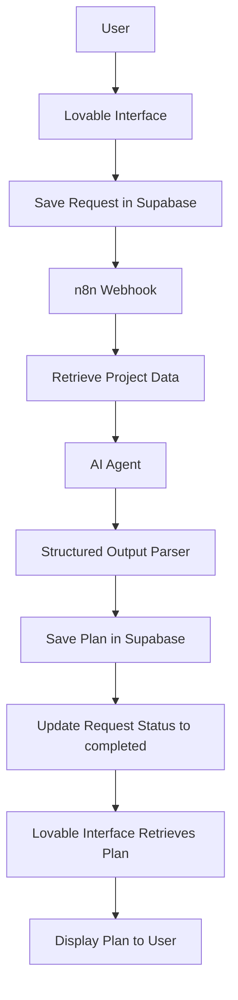

# 🧩 PlanCraft AI — Build, Connect, Automate

[English](README.md) | [العربية](README.ar.md)

## 📌 Overview

**PlanCraft AI** is an application that helps users turn project ideas into practical, structured plans using artificial intelligence.

Users enter their project details through the application interface. The system then processes the request using an n8n workflow, generates a structured plan, and saves it in the database so it can be retrieved and displayed to the user.

The project integrates three main tools:

- **Lovable:** Builds the application interface and user experience.
- **Supabase:** Stores project requests and generated plans, and manages processing status.
- **n8n Cloud:** Automates the workflow and connects the database with the AI Agent.

## ⚠️ Problem Statement

People with project ideas may find it difficult to turn those ideas into clear, actionable steps, such as:

- Defining the main project objective.
- Dividing the work into phases.
- Identifying the actions required for implementation.
- Identifying potential risks.
- Estimating the time required to complete the project.
- Determining the next steps to get started.

## 💡 Proposed Solution

PlanCraft AI provides an application that transforms project details into a structured plan using artificial intelligence. The generated plan includes:

1. Project summary.
2. Main objective.
3. Implementation phases.
4. Suggested actions.
5. Potential risks and mitigation strategies.
6. Estimated implementation timeline.

**Core Value:** Transforming an initial idea into an organized, reviewable action plan.

> Note: The generated plan is a suggestion to support the user's planning process. It does not guarantee project success or the accuracy of all estimates.

## 👥 Target Audience

- People with project ideas who need help organizing them.
- Entrepreneurs and small business owners.
- Individuals who want to turn their goals into clear, actionable steps.
- Users who need a structured starting point for project planning.

## ⚙️ System Workflow

## 🧰 Technologies and Tools

- **Lovable:** Builds the application interface.
- **Supabase:** Stores project requests and generated plans, and manages request status.
- **n8n Cloud:** Automates the workflow and coordinates integration between services.
- **AI Agent:** Generates the project plan using artificial intelligence.
- **Structured Output Parser:** Structures AI-generated output according to a predefined format.
- **Webhook (HTTP POST):** Sends the request to the n8n workflow.
- **JSON:** Enables data exchange between system components.

## 🔄 Workflow Explanation

1. **Data Entry:** The user enters project details through the Lovable interface.
2. **Request Storage:** Project details are saved in the `project_requests` table in Supabase.
3. **Processing Initiation:** The application sends a request to an n8n Webhook.
4. **Data Retrieval:** The workflow retrieves the project data from the database.
5. **Plan Generation:** The AI Agent processes the project details and generates a proposed plan.
6. **Output Structuring:** The system uses the Structured Output Parser to organize the result.
7. **Plan Storage:** The generated plan is saved in the `project_plans` table.
8. **Status Update:** The request status is updated after processing is completed.
9. **Result Display:** The interface tracks the request status, retrieves the saved plan, and displays it to the user.

## 🗄️ Data Management

The application relies on two main tables in Supabase:

- `project_requests`: Stores the project details entered by the user and the processing status.
- `project_plans`: Stores the plans generated by the AI.

Separating requests from plans helps organize the data and link each generated plan to its corresponding project request.

## 🧪 Testing

The workflow was tested to verify the integration between the application interface, Supabase, and n8n, and to ensure that project requests are processed and generated plans are saved.

- **Request Submission Test:** Verified that project details are saved in the `project_requests` table.
- **Integration Test:** Verified that the request reaches the n8n Webhook and that project data is retrieved.
- **Plan Generation Test:** Verified that the AI Agent can generate a structured plan based on the project details.
- **Output Formatting Test:** Verified that the generated result matches the predefined structure using the Structured Output Parser.
- **Result Storage Test:** Verified that the generated plan is saved in the `project_plans` table.
- **Request Status Test:** Verified that the request status is updated after processing is completed.
- **Result Display Test:** Verified that the saved plan is retrieved and displayed in the application interface.

## ✨ Key Features

- Transforming project ideas into structured plans.
- Breaking projects down into reviewable phases and actions.
- Suggesting potential risks and ways to address them.
- Saving generated results in the database instead of relying on temporary outputs.
- Tracking request status during processing.
- Integrating the user interface, database, and automation into one connected system.

## 🎯 Learning Objectives

- Understanding the relationship between Frontend, Backend, and Database.
- Building an application using an AI App Builder.
- Designing a database that meets application requirements.
- Using Webhooks and HTTP requests to connect systems.
- Exchanging data in JSON format.
- Building an end-to-end workflow using n8n.
- Working with AI Agents and Structured Output Parsers.
- Saving generated outputs and managing request status.
- Testing integrations and identifying errors.
- Considering data security and consistency.

## 🚀 Future Improvements

- Allowing users to edit generated plans and save their changes.
- Providing the option to regenerate a plan when needed.
- Adding a history of previous plans for each project.
- Improving output validation before saving generated plans.
- Developing error-handling and retry mechanisms.
- Adding the ability to export plans in different formats.

## ✅ Conclusion

PlanCraft AI is a practical implementation of system integration and process automation using artificial intelligence. It combines a user interface, a database, and an automated workflow to transform project details into a structured plan, save it, and display it to the user.

The project demonstrates how to build an integrated application that goes beyond generating an AI response by managing the entire request lifecycle, from data submission and processing to saving and displaying the final result.

[Project](https://pixel-perfect-replay-6860.lovable.app)
