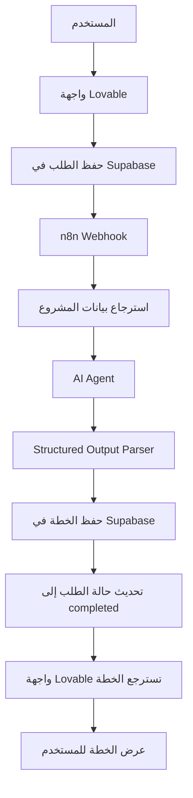

# 🧩 PlanCraft AI — Build, Connect, Automate

## 📌 نظرة عامة

**PlanCraft AI** هو تطبيق يساعد المستخدم على تحويل فكرة المشروع إلى خطة عملية منظمة باستخدام الذكاء الاصطناعي.

يدخل المستخدم تفاصيل مشروعه عبر واجهة التطبيق، ثم يعالج النظام الطلب باستخدام Workflow في n8n، وينشئ خطة منظمة ويحفظها في قاعدة البيانات لتُعرض على المستخدم.

يعتمد المشروع على تكامل ثلاث أدوات رئيسية:

- **Lovable:** بناء واجهة التطبيق وتجربة المستخدم.
- **Supabase:** تخزين طلبات المشاريع والخطط الناتجة وإدارة حالة المعالجة.
- **n8n Cloud:** أتمتة سير العمل وربط قاعدة البيانات بوكيل الذكاء الاصطناعي.

## ⚠️ المشكلة التي يعالجها

قد يواجه أصحاب الأفكار صعوبة في تحويل أفكار مشاريعهم إلى خطوات عملية واضحة، مثل:

- تحديد الهدف الرئيسي للمشروع.
- تقسيم العمل إلى مراحل.
- تحديد الإجراءات اللازمة للتنفيذ.
- اكتشاف المخاطر المحتملة.
- تقدير المدة اللازمة لإنجاز المشروع.
- تحديد الخطوات التالية للبدء.

## 💡 الحل المقترح

يوفر PlanCraft AI تطبيقًا يحوّل تفاصيل المشروع إلى خطة منظمة باستخدام الذكاء الاصطناعي، تتضمن:

1. ملخص المشروع.
2. الهدف الرئيسي.
3. مراحل التنفيذ.
4. الإجراءات المقترحة.
5. المخاطر وطرق الحد منها.
6. المدة التقديرية للتنفيذ.

**القيمة الأساسية:** من فكرة أولية إلى خطة عمل منظمة وقابلة للمراجعة.

> ملاحظة: الخطة الناتجة اقتراح يساعد المستخدم على التخطيط، وليست ضمانًا لنجاح المشروع أو لصحة جميع التقديرات.

## 👥 الفئة المستهدفة

- الأشخاص الذين لديهم أفكار مشاريع ويحتاجون إلى تنظيمها.
- رواد الأعمال وأصحاب المشاريع الصغيرة.
- الأفراد الذين يرغبون في تحويل أهدافهم إلى خطوات تنفيذية واضحة.
- المستخدمون الذين يحتاجون إلى نقطة بداية منظمة للتخطيط لمشاريعهم.

## ⚙️ آلية عمل النظام

## 🧰 التقنيات والأدوات المستخدمة

- **Lovable:** بناء واجهة التطبيق.
- **Supabase:** تخزين طلبات المشاريع والخطط وإدارة حالة الطلب.
- **n8n Cloud:** أتمتة سير العمل وتنسيق التكامل بين الخدمات.
- **AI Agent:** إنشاء خطة المشروع باستخدام الذكاء الاصطناعي.
- **Structured Output Parser:** تنظيم مخرجات الذكاء الاصطناعي وفق بنية محددة.
- **Webhook (HTTP POST):** تمرير الطلب إلى Workflow في n8n.
- **JSON:** تبادل البيانات بين مكونات النظام.

## 🔄 سير العمل

1. **إدخال البيانات:** يدخل المستخدم تفاصيل المشروع عبر واجهة Lovable.
2. **حفظ الطلب:** تُحفظ بيانات المشروع في جدول `project_requests` داخل Supabase.
3. **بدء المعالجة:** يُرسل التطبيق طلبًا إلى Webhook في n8n.
4. **استرجاع البيانات:** يستخرج Workflow بيانات المشروع من قاعدة البيانات.
5. **توليد الخطة:** يعالج AI Agent بيانات المشروع وينشئ خطة مقترحة.
6. **تنظيم المخرجات:** يستخدم النظام Structured Output Parser لتنظيم النتيجة.
7. **حفظ الخطة:** تُحفظ الخطة الناتجة في جدول `project_plans`.
8. **تحديث الحالة:** تُحدّث حالة الطلب بعد اكتمال المعالجة.
9. **عرض النتيجة:** تتابع الواجهة حالة الطلب وتسترجع الخطة المحفوظة لعرضها للمستخدم.

## 🗄️ إدارة البيانات

يعتمد التطبيق على جدولين رئيسيين في Supabase:

- `project_requests`: تخزين بيانات المشروع التي أدخلها المستخدم وحالة المعالجة.
- `project_plans`: تخزين الخطط الناتجة عن الذكاء الاصطناعي.

يساعد فصل الطلبات عن الخطط على تنظيم البيانات وربط كل خطة بطلب المشروع الخاص بها.

## 🧪 الاختبارات

تم اختبار سير العمل للتحقق من تكامل واجهة التطبيق مع Supabase وn8n، والتأكد من معالجة طلبات المشاريع وحفظ الخطط الناتجة.

- **اختبار إرسال الطلب:** التحقق من حفظ بيانات المشروع في جدول `project_requests`.
- **اختبار التكامل:** التحقق من وصول الطلب إلى Webhook في n8n واسترجاع بيانات المشروع.
- **اختبار توليد الخطة:** التحقق من قدرة AI Agent على إنشاء خطة منظمة بناءً على بيانات المشروع.
- **اختبار تنسيق المخرجات:** التحقق من توافق النتيجة مع البنية المحددة باستخدام Structured Output Parser.
- **اختبار حفظ النتائج:** التحقق من حفظ الخطة في جدول `project_plans`.
- **اختبار حالة الطلب:** التحقق من تحديث حالة الطلب بعد اكتمال المعالجة.
- **اختبار عرض النتيجة:** التحقق من استرجاع الخطة المحفوظة وعرضها في واجهة التطبيق.

## ✨ المميزات الرئيسية

- تحويل أفكار المشاريع إلى خطط منظمة.
- تقسيم المشروع إلى مراحل وإجراءات قابلة للمراجعة.
- اقتراح مخاطر محتملة وطرق للتعامل معها.
- حفظ النتائج في قاعدة البيانات بدلًا من الاعتماد على مخرجات مؤقتة.
- متابعة حالة الطلب خلال المعالجة.
- ربط واجهة المستخدم وقاعدة البيانات والأتمتة ضمن نظام متكامل.

## 🎯 أهداف التعلم

- فهم العلاقة بين Frontend وBackend وDatabase.
- بناء تطبيق باستخدام AI App Builder.
- تصميم قاعدة بيانات تناسب احتياجات التطبيق.
- استخدام Webhooks وطلبات HTTP لربط الأنظمة.
- تبادل البيانات بصيغة JSON.
- بناء Workflow متكامل باستخدام n8n.
- استخدام AI Agent وStructured Output Parser.
- حفظ المخرجات وإدارة حالة الطلب.
- اختبار التكامل واكتشاف الأخطاء.
- مراعاة أمن البيانات واتساقها.

## 🚀 التطويرات المستقبلية

- إتاحة تعديل الخطط الناتجة وحفظ التغييرات.
- توفير إمكانية إعادة توليد الخطة عند الحاجة.
- إضافة سجل للخطط السابقة لكل مشروع.
- تحسين التحقق من صحة المخرجات قبل حفظها.
- تطوير آليات معالجة الأخطاء وإعادة المحاولة.
- إضافة إمكانية تصدير الخطط بصيغ مختلفة.

## ✅ الخلاصة

يمثل PlanCraft AI تطبيقًا عمليًا على تكامل الأنظمة وأتمتة العمليات باستخدام الذكاء الاصطناعي. فهو يجمع بين واجهة المستخدم وقاعدة البيانات وWorkflow آلي لتحويل بيانات المشروع إلى خطة منظمة، ثم حفظها وعرضها للمستخدم.

يوضح المشروع كيفية بناء تطبيق متكامل يتجاوز توليد إجابة بالذكاء الاصطناعي إلى إدارة دورة الطلب من الإدخال والمعالجة حتى حفظ النتيجة وعرضها

[المشروع](https://pixel-perfect-replay-6860.lovable.app)
